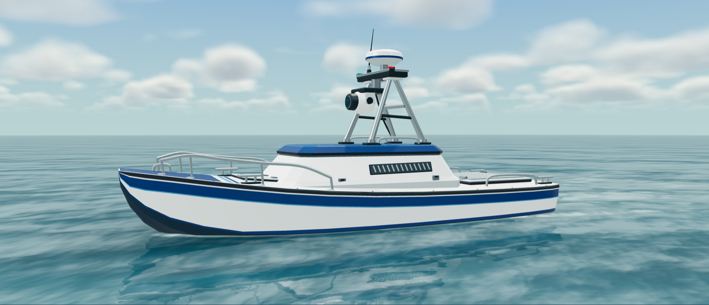
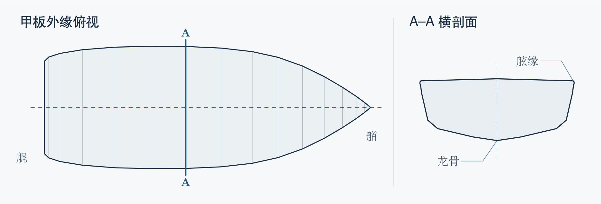
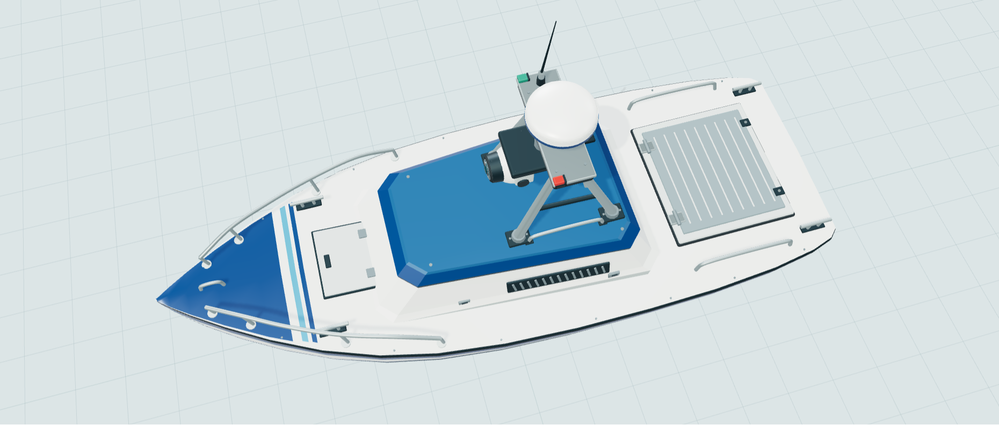
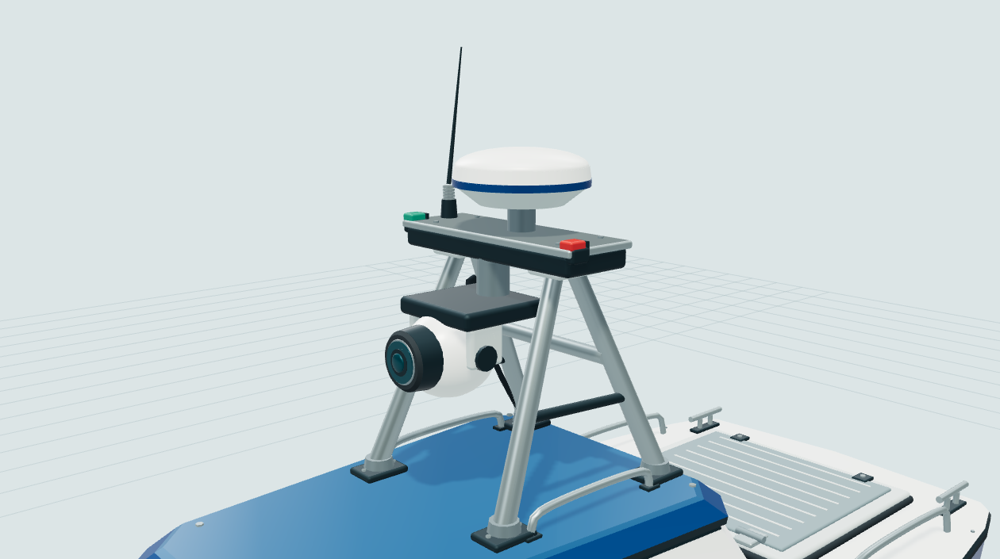
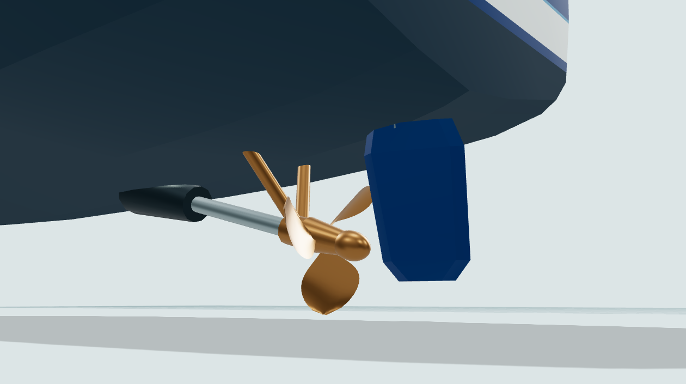

# 基于 GPT-6.2 Astra 制作的水面无人艇

用 Three.js 构建的蓝白单体无人艇。船壳由横剖面放样生成，甲板设备、桅杆、螺旋桨与舵叶分组装配。网页支持环绕检视、部件特写、交互试航及 GLB 导出。

[阅读两页中文项目文档](docs/usv.pdf) · [LaTeX 源码](docs/usv.tex) · [下载 GLB 船模](水面无人艇.glb)



## 船壳型线

左图是船壳的俯视轮廓。沿 A–A 线剖开，可以看到右图中从龙骨向两舷抬升的浅 V 形艇底。



## 甲板与部件

从艇艏向艉部看，前检修口、蓝色设备舱盖和带防滑筋的艉部检修盖依次排开。



| 仪器桅杆 | 艉部桨舵 |
| --- | --- |
|  |  |

## 本地运行

```sh
npm ci
npm run dev
```

打开终端显示的本机地址即可试航。`npm run build` 会生成可离线打开的单文件网页 `dist/index.html`。

## 编译文档

在包含中文语言包的 TeX Live 环境中运行以下命令。配图位于 `docs/figures`。

```sh
cd docs
latexmk -xelatex usv.tex
```
